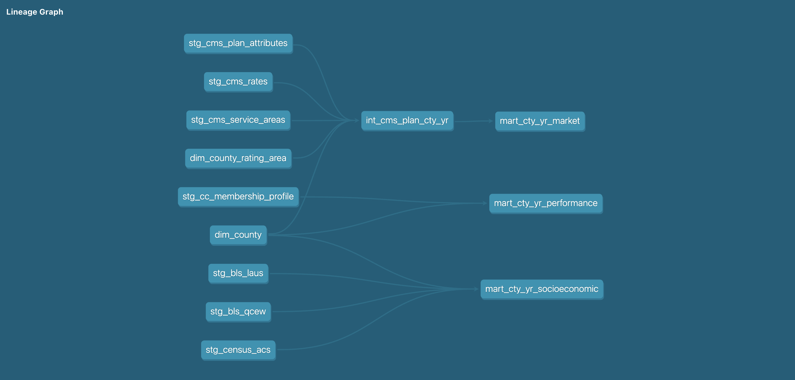

<p align="center">
  
</p>

<p align="center">
  
  
  
  
  
  
  
  
</p>

## Overview

This project analyzes California's individual ACA Marketplace at the county-year level using public data from CMS, Covered California, the U.S. Census Bureau, and the U.S. Bureau of Labor Statistics.

First, a profile for Kaiser Permanente's performance in the Marketplace is built from the socioeconomic and market conditions of the counties where it is offered. Then counties are compared against that profile to find where Kaiser's share sits well above or below what their conditions imply. The profile is tested across years, regions, and individual counties, and recent trends are extended five to ten years to see whether the county ranking shifts. The result is a short list of counties and questions for future analysis.

Yearly CSVs are ingested into a DuckDB warehouse and transformed with dbt. Historical analysis uses three county-year marts as a panel in statsmodels notebooks; a separate forecast-input mart feeds the 2027 share screen.

## Research Questions

- What socioeconomic and market characteristics across geographies are associated with Marketplace performance?
- Which areas currently exhibit these characteristics and outcomes?
- How are these socioeconomic and market characteristics expected to change over the next five to ten years?
- What considerations for future market analysis emerge from these findings?

## Project Scope

- **Geography:** California counties
- **Primary analytical grain:** county × year
- **Market:** ACA Individual Marketplace
- **Organization of interest:** Kaiser Permanente
- **Market data:** CMS California State-Based Exchange QHP Public Use Files
- **Performance data:** Covered California Active Member Profiles
- **Socioeconomic data:** Census ACS and BLS LAUS/QCEW
- **Historical analysis:** annual county-level observations
- **Performance measure:** Kaiser Permanente's share of Covered California enrollment in counties where it is offered
- **Forecasting horizon:** five to ten years

## Data Sources

| Source | Dataset / File | Measures Used |
|---|---|---|
| CMS | [California SBE QHP PUF — Service Area](https://www.cms.gov/marketplace/resources/data/state-based-public-use-files) | Issuer service areas, counties served, market coverage |
| CMS | [California SBE QHP PUF — Plan Attributes](https://www.cms.gov/marketplace/resources/data/state-based-public-use-files) | Issuers, plans, metal levels, plan types, service areas, network IDs |
| CMS | [California SBE QHP PUF — Rates](https://www.cms.gov/marketplace/resources/data/state-based-public-use-files) | Rating areas and standardized individual premiums |
| Covered California | [Active Member Profiles](https://hbex.coveredca.com/data-research/active-member-profiles/) | Issuer enrollment by county, total Marketplace enrollment, Kaiser Permanente enrollment and market share |
| Covered California | [Data & Research — 2027 QHP Rates and Plans by ZIP](https://www.hbex.ca.gov/data-research/) | 2027 age-40 Silver benchmarks and issuer presence for the forecast seed |
| CA Department of Finance | [P-2 County Population Projections](https://dof.ca.gov/forecasting/demographics/projections/) | 2027 county population (Report P-2A, Baseline 2024 / Vintage 2026) |
| CA Department of Finance | [Long-Run County Level Forecasts](https://dof.ca.gov/forecasting/economics/economic-forecasts-u-s-california-counties/long-run-county-level-forecasts/) | 2027 county unemployment rates (DOF / Caltrans, Jan 2026) |
| U.S. Census Bureau | [ACS B01003 — Total Population](https://data.census.gov/table?q=B01003:+TOTAL+POPULATION) | County population |
| U.S. Census Bureau | [ACS B19013 — Median Household Income](https://data.census.gov/table/ACSDT5Y2024.B19013) | Median household income |
| U.S. Census Bureau | [ACS S1701 — Poverty Status](https://data.census.gov/table?q=S1701:+POVERTY+STATUS+IN+THE+PAST+12+MONTHS) | Poverty rate |
| U.S. Census Bureau | [ACS S2701 — Health Insurance Coverage](https://data.census.gov/table?q=S2701:+HEALTH+INSURANCE+COVERAGE+STATUS) | Uninsured rate |
| BLS | [Local Area Unemployment Statistics (LAUS)](https://www.bls.gov/lau/tables.htm) | Labor force, employment, unemployment, unemployment rate |
| BLS | [Quarterly Census of Employment and Wages (QCEW)](https://www.bls.gov/cew/downloadable-data-files.htm) | Establishments, employment, average annual pay, annual changes |
| U.S. Census Bureau | [2023 Cartographic Boundary File — Counties, 1:5M](https://www2.census.gov/geo/tiger/GENZ2023/shp/cb_2023_us_county_5m.zip) | County outlines for the notebook 5 map |

Raw public-use files are not committed to the repository.

## Architecture
<p align="center">
  
</p>

The project uses a local DuckDB database as the analytical warehouse and dbt for SQL transformations, testing, lineage, and documentation.

## Data Model

### Staging

Staging models clean and standardize individual source datasets while retaining their source-level grain.

| Model | Source | Purpose |
|---|---|---|
| `stg_cms_service_areas` | CMS Service Area PUF | Standardized issuer service-area and county records |
| `stg_cms_plan_attributes` | CMS Plan Attributes PUF | Standardized Individual Marketplace plan attributes |
| `stg_cms_rates` | CMS Rate PUF | Standardized plan/rating-area premium records |
| `stg_cc_membership_profile` | Covered California | Standardized county × issuer enrollment records |
| `stg_census_acs` | Census ACS | Standardized county socioeconomic measures |
| `stg_bls_laus` | BLS LAUS | Standardized county labor-force measures |
| `stg_bls_qcew` | BLS QCEW | Standardized county employment and establishment measures |

### Reference Seeds

| Seed | Purpose |
|---|---|
| `dim_county` | Canonical California county names, state identifiers, and five-digit county FIPS codes |
| `dim_county_rating_area` | Mapping between California counties and ACA geographic rating areas |

Los Angeles County is not assigned a single rating area in `dim_county_rating_area` because it spans two ACA rating areas. County-level premium metrics for Los Angeles are therefore left null.

### Intermediate

#### `int_cms_plan_cty_yr`

**Grain:** one row per plan × county × year.

This model:

- joins CMS Plan Attributes and Service Area data;
- standardizes county geography through `dim_county`;
- maps counties to ACA rating areas;
- attaches the standardized age-40 individual premium from the CMS Rate PUF;
- identifies Kaiser Permanente plans;
- retains Individual, non-dental, on-exchange plans.

For premium comparisons, the model uses:

- age `40`;
- tobacco value `No Preference`;
- `individual_rate`;
- the earliest available rate period within each plan × rating area × year.

CMS Rate PUF `plan_id` values are matched to Plan Attributes `standard_component_id`.

### Analytical Marts

#### `mart_cty_yr_market`

**Grain:** one row per county × year.

Includes:

- carrier count;
- plan count;
- Silver plan count;
- Gold plan count;
- lowest-cost Silver premium;
- benchmark Silver premium;
- carrier entries;
- carrier exits;
- Kaiser Permanente availability;
- Kaiser Permanente plan count.

Plan availability counts use distinct `standard_component_id` values rather than cost-sharing variant-level plan IDs.

#### `mart_cty_yr_performance`

**Grain:** one row per county × year.

Includes:

- Kaiser Permanente enrollment;
- total Marketplace enrollment;
- Kaiser Permanente market share;
- year-over-year Kaiser Permanente enrollment growth;
- year-over-year total Marketplace enrollment growth;
- year-over-year change in Kaiser Permanente market share.

#### `mart_cty_yr_socioeconomic`

**Grain:** one row per county × year.

Includes:

- total population;
- year-over-year population growth;
- median household income;
- poverty rate;
- uninsured rate;
- labor force;
- employment and unemployment;
- unemployment rate;
- establishment count;
- QCEW employment;
- average annual pay;
- year-over-year establishment, employment, and pay changes.

#### `mart_cty_forecast_inputs`

**Grain:** one row per county × forecast year × scenario × measure.

Holds forward covariates for notebook 7. Kept separate from the historical county-year marts. Loaded from the `forecast_cty_inputs` seed:

| Measure | Source in the seed |
|---|---|
| `population_total` | DOF P-2A July 1 2027 |
| `unemployment_rate` | DOF / Caltrans long-run county forecast, 2027 |
| `benchmark_silver_premium` | Covered CA 2027 QHP rates (second-lowest Silver, age 40, issuers present in county) |
| `carrier_count` | Covered CA 2027 plans-by-ZIP |
| `uninsured_rate`, `median_household_income`, `poverty_rate` | ACS 2024 hold (no official county 2027 uninsured forecast) |

Scenarios: `base`, `higher_uninsured` (+1 pp), `softer_labor` (+1 pp unemployment), `premium_up` (+$50 benchmark).

## Methodology

### Data Engineering

Raw files are loaded into DuckDB through dbt staging models. Transformations follow three layers:

1. **Staging** — source cleaning, column standardization, type casting, and basic normalization.
2. **Intermediate** — reusable grain-changing and cross-source business logic.
3. **Marts** — final county-year analytical tables used for analysis and modeling.

County FIPS codes are used as the primary geographic join key. Canonical county attributes are supplied through the `dim_county` seed.

dbt tests are used to validate expected analytical grains and required identifiers.

### Exploratory and Statistical Analysis

The unit is one row per county where Kaiser is offered, averaged over 2016–2024. The outcome is Kaiser market share. Los Angeles has no county premium and Monterey opens in 2025, so most models use 31 counties.

| Notebook | Question | Method |
|---|---|---|
| `01_eda` | Where does Kaiser perform, and what lines up with share? | Rankings, trends, Spearman correlations |
| `02_relationship_analysis` | Which associations hold together? | Nested OLS with HC1 standard errors |
| `03_forecasting` | Does the share ranking move if recent paces continue? | Relative 2019–2024 slopes run through Model 2 |
| `04_model_stability` | Does the fit depend on terms, years, regions, or single counties? | Refits of a four-term profile, including a Northern/Southern California split |
| `05_profile_departures` | Which counties depart from the profile, and does share follow a county's own changes? | Residuals, county and year fixed effects, opening paths, nearest-neighbor screen |
| `06_where_model_works` | Where is absolute error low or high, and what does that say about the tool? | Absolute residuals sliced by conditions, footprint, and region |
| `07_forecast_2027` | What share does the profile imply for 2027 conditions? | Frozen four-term score on forecast inputs plus sticky departures |

Model specifications, sample rules, and full results are in [`docs/analysis.md`](docs/analysis.md).

### Forecasting

Two forecast products answer different questions:

- **Notebook 3** continues each county's 2019–2024 relative pace for the uninsured rate, population, and benchmark premium five and ten years forward. It shows how the **ranking** moves; it is not a 2027 share-level forecast.
- **Notebook 7** applies the frozen four-term profile to 2027 covariate inputs in `mart_cty_forecast_inputs`, then adds each county's historical departure. That is a **screening forecast of share**, with ±1 residual-SE bands and input scenarios. The seed uses DOF 2027 population and unemployment, Covered California 2027 premiums and carrier counts, and ACS 2024 holds for uninsured / income / poverty.

### Visualization

Notebooks build their figures with matplotlib and save copies to `outputs/figures/`. The notebook 5 county map reads the Census boundary file with `pyshp`.


## Results

Details and figure references are in [`docs/analysis.md`](docs/analysis.md). A presenter-oriented write-up of notebooks 6–7 is in [`docs/briefing_model_fit_and_2027_forecast.md`](docs/briefing_model_fit_and_2027_forecast.md).

- **Profile.** Across 31 offered counties, Kaiser share is higher in larger counties, where uninsured and unemployment rates are lower, and where the benchmark Silver premium is higher (four terms, adjusted R² 0.60). The benchmark result reads as Kaiser's price position, since Kaiser's gap to the benchmark moves almost one-for-one against it (correlation −0.88).
- **Region.** Southern California counties sit about 19 points below Northern California counties with the same conditions. Within Northern California, population (+) and unemployment (−) hold (adjusted R² 0.71).
- **Stability.** Signs hold in every single year and with any one county dropped. They shift when a whole region is dropped.
- **Within a county.** Only 3% of share variation happens inside a county over time. Of the four terms, only the benchmark premium tracks share there.
- **Departures.** Sutter, Orange, San Francisco, Santa Clara, and Tulare sit well below their profile, with or without region. Orange is the largest gap in members, at roughly 30,000–41,000 at 2025 market size. Napa, Solano, and San Joaquin sit well above.
- **Where the tool works.** Absolute residual error is not sorted by income, poverty, or the profile terms themselves. High `|error|` concentrates in the same shortfall and outperformer counties. The socioeconomic / market model is best used as a between-county **screening score** with a confidence tag, not as a within-county lever.
- **Outlook (ranking).** Continuing 2019–2024 relative paces moves the median county about one point over five years, and the high- and low-share groups do not trade places. Monterey opened at 29%, against Santa Cruz's 41% in its first year (2017) and about 65% since.
- **2027 share screen.** On official 2027 DOF / Covered California inputs, the frozen profile plus sticky departures produces county share scores with ±16 pp model bands; input scenarios span about 13 pp at the median. Higher 2027 Silver benchmarks lift many profile scores (median sticky share ~87%, often clipped at 100% in high-premium Northern counties). Los Angeles is unscored; Monterey is an opening score only.

## Limitations

Documented data/modeling constraints include:

- Los Angeles County spans multiple ACA rating areas, so a single county-level premium is not assigned.
- CMS source schemas and field completeness vary across file vintages.
- CMS Rate PUF `qhp_non_qhp_type_id` is not consistently populated across years; on-exchange status is therefore established through the filtered Plan Attributes records rather than requiring the corresponding Rate PUF field.
- Premium measures use a standardized age-40 individual rate with tobacco status reported as `No Preference`.
- Where multiple rate periods exist within a plan year, the earliest available rate period is used.
- Socioeconomic source availability varies by year, so coverage of the socioeconomic mart is determined by available source-year combinations.

- Models compare 31 counties in one state, so intervals are wide and results describe this footprint.
- "Offered" includes 23 counties where Kaiser's service area covers only some ZIP codes, while share uses all Covered California members in the county.
- Kaiser facility locations and provider networks are not in the data.
- Notebook 3's relative-pace projection covers socioeconomic and premium drift only. It leaves out subsidy policy, footprint changes, and Kaiser pricing.
- Notebook 7 sticky departures assume Kaiser-specific gaps persist. Shares are clipped to 0–100% for display. County uninsured rates are still ACS 2024 holds. 2027 benchmarks are built from Covered California rating-area rates filtered to issuers present in each county; they are not a full CMS PUF rebuild.

## Future Work

- Replace ACS 2024 uninsured holds if a credible county 2027 uninsured source appears; optionally rebuild 2027 premiums from a CMS CA SBE Rate PUF when published.
- Relate share to distance from Kaiser medical centers and to ZIP-level service areas.
- Explain the shortfall counties, starting with Orange, and study the outperformers.
- Treat openings and service-area changes as events to test whether any condition acts as a lever.
- Fit Northern and Southern California separately as more years accumulate.
- Track Monterey's 2026–2027 share against the Santa Cruz path.

## Repository Structure

```text
kp-marketplace-analysis/
│
├── README.md
├── .gitignore
├── requirements.txt
│
├── data/
│   ├── raw/                         # gitignored source files
│   ├── processed/                   # gitignored DuckDB database / generated data
│
├── dbt/
│   ├── dbt_project.yml
│   ├── models/
│   │   ├── staging/
│   │   │   ├── covered_ca/
│   │   │   ├── census/
│   │   │   ├── bls/
│   │   │   ├── cms/
│   │   │   └── forecasts/
│   │   │
│   │   ├── intermediate/
│   │   │   └── int_cms_plan_cty_yr.sql
│   │   │
│   │   └── marts/
│   │       ├── mart_cty_yr_market.sql
│   │       ├── mart_cty_yr_performance.sql
│   │       ├── mart_cty_yr_socioeconomic.sql
│   │       └── mart_cty_forecast_inputs.sql
│   │
│   └── seeds/
│       ├── dim_county.csv
│       ├── dim_county_rating_area.csv
│       └── forecast_cty_inputs.csv  # 2027 bridge / official forecast inputs
│
├── notebooks/                       # run from this folder
│   ├── 01_eda.ipynb
│   ├── 02_relationship_analysis.ipynb
│   ├── 03_forecasting.ipynb
│   ├── 04_model_stability.ipynb
│   ├── 05_profile_departures.ipynb
│   ├── 06_where_model_works.ipynb
│   └── 07_forecast_2027.ipynb
│
├── outputs/
│   ├── figures/                     # PNG copies of notebook figures
│   └── notebooks/                   # HTML exports
│
├── reports/                         # phase reports (PDF)
│
└── docs/
    ├── analysis.md                  # model specs and full results
    ├── briefing_model_fit_and_2027_forecast.md
    └── assets/
```

## Disclaimer

This is an SFSU BUS 895 student capstone prepared for a Kaiser Permanente client. Findings are for academic discussion. They do not represent Kaiser Permanente.

## Setup

### 1. Clone the repository

```bash
git clone <REPOSITORY_URL>
cd kp-marketplace-analysis
```

### 2. Create and activate a virtual environment

```bash
python3.14 -m venv .venv
source .venv/bin/activate
```

### 3. Install dependencies

```bash
pip install -r requirements.txt
```

### 4. Download source data

Raw source files are excluded from version control. Place each source under `data/raw/` in its folder (`bls/`, `census/`, `cms/`, `covered_ca/`). The county boundary zip goes in `data/raw/census/boundaries/` unextracted.

### 5. Configure dbt

The dbt project uses the `kp_analysis` profile and a DuckDB database.

Example profile:

```yaml
kp_analysis:
  outputs:
    dev:
      type: duckdb
      path: data/processed/analysis.duckdb
      threads: 4
  target: dev
```

The exact database path should correspond to the working-directory convention used when running dbt.

### 6. Install dbt packages

```bash
dbt deps
```

### 7. Load reference seeds

```bash
dbt seed --full-refresh
```

### 8. Build and test the warehouse

```bash
dbt build
```

The final analytical models are:

```text
mart_cty_yr_market
mart_cty_yr_performance
mart_cty_yr_socioeconomic
mart_cty_forecast_inputs
```

`mart_cty_forecast_inputs` holds county × year × scenario × measure forecast covariates for notebook 7. It is loaded from the `forecast_cty_inputs` seed and is kept separate from the historical year marts.

### 9. Run the notebooks

Run notebooks from `notebooks/`. They open `../data/processed/analysis.duckdb` read-only, and the staging views read `../data/raw`.