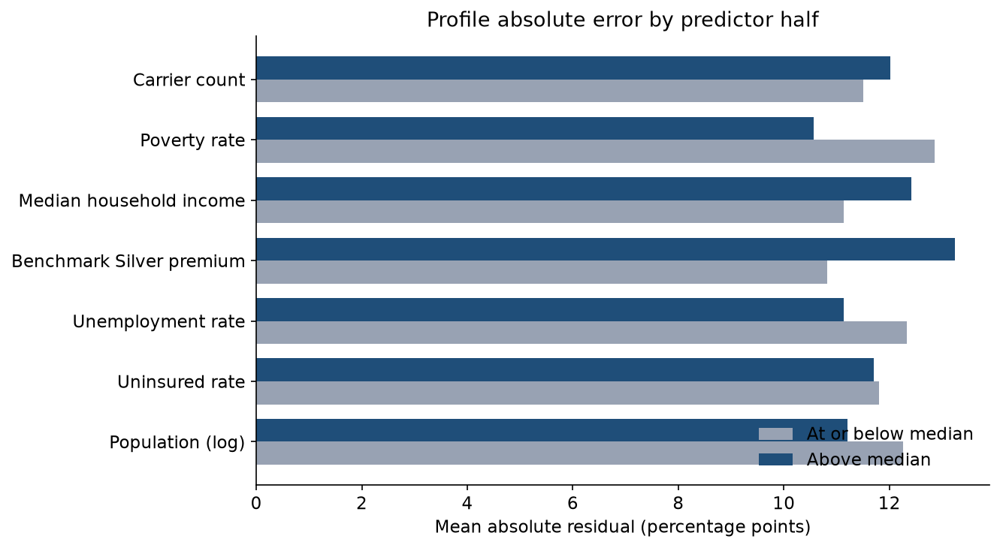
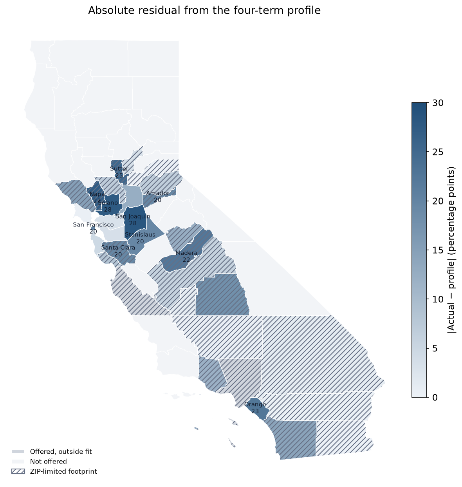
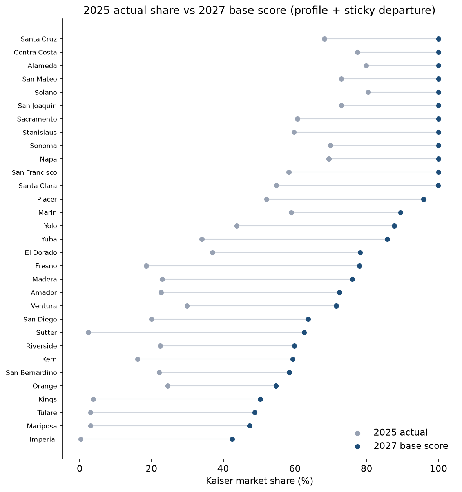

# Briefing: Where the Model Works + 2027 Share Screen

A short presenter note for the two additions after notebooks 1–5. Use this with the figures in `outputs/figures/`.

---

## One-sentence pitch

We now tell Kaiser two things the earlier work did not: **where the socioeconomic score is trustworthy**, and **what that score says about 2027 county conditions** once official population, unemployment, and premium inputs are plugged in.

---

## What was already true (quick refresh)

Across offered counties, Kaiser share lines up with four conditions:

- larger population  
- lower uninsured rate  
- lower unemployment  
- higher benchmark Silver premium (read as Kaiser’s price position)

That four-term **profile** is a between-county screen (adj. R² ~0.60). It is **not** a good year-to-year lever inside a county (~3% of share variation). Some counties sit far above or below what their conditions imply (notebook 5 departures).

---

## Addition 1 — Notebook 06: where the model works

### Question

When does the profile land close to actual share, and what does that say about using it as a tool?

### How to say it

There are two different “errors”:

| Idea | Meaning | Use |
|---|---|---|
| **Absolute error** \|actual − predicted\| | How reliable is the score? | Confidence / tool quality |
| **Signed departure** actual − predicted | Over or under vs conditions | Shortfall / outperformer story (notebook 5) |

### What we found

- Median absolute error ≈ **12** percentage points of share. Residual SE ≈ **16.4** pp.
- **14** counties are within half an SE (Higher confidence). **11** are beyond one SE (Lower confidence).
- High absolute error is basically the same shortfall and outperformer list from before (Orange, Sutter, SF, Santa Clara, Napa, Solano, San Joaquin, …).
- Absolute error is **not** sorted by income, poverty, or the profile terms. This is not “works only in rich counties.”

**Presenter line:** *The tool fails where Kaiser is unusually strong or weak relative to local conditions — not because a county is poor or small.*

### Confidence groups (use these labels)

- **Higher:** Imperial, Riverside, Placer, Marin, Kern, Kings, San Bernardino, Contra Costa, Alameda, Yuba, San Mateo, Fresno, El Dorado, Yolo  
- **Lower:** the large departure counties (shortfalls and outperformers)

### Decision rule for Kaiser

1. Use the profile to **screen** counties.  
2. Check the confidence tag before acting.  
3. Do not treat a high predicted share as “Kaiser will get that” without residual + Northern/Southern context.

### Visuals



*Mean absolute residual barely changes between lower and upper halves of each predictor — SES level is not the reliability story.*



*Darker = larger absolute miss. Hatching = ZIP-limited footprint.*

---

## Addition 2 — Notebook 07: 2027 share screen

### Question

Given **2027 conditions**, what share does the same tool imply?

### Formula (say this out loud)

**2027 score = frozen profile(2027 conditions) + sticky historical departure**

- Frozen profile = the same four coefficients from history.  
- Sticky departure = each county’s long-run gap vs that profile (Kaiser-specific factors the SES model does not see).  
- This is **not** notebook 3’s relative ranking exercise.

### Official inputs now in the seed

| Input | Source |
|---|---|
| Population | CA DOF P-2A, July 1 **2027** |
| Unemployment | DOF / Caltrans long-run county forecast, **2027** |
| Benchmark Silver premium | Covered California **2027** QHP rates (age 40, second-lowest Silver among issuers in the county) |
| Carrier count | Covered California **2027** plans-by-ZIP |
| Uninsured / income / poverty | Still ACS **2024** hold (no good county 2027 uninsured forecast) |

Scenarios on top of base: uninsured +1 pp, unemployment +1 pp, premium +$50.

### What changed when official premiums replaced the 2026 bridge

2027 Covered California Silver benchmarks are roughly **$35–$130** higher than the old 2026 bridge values. Because the historical profile associates higher benchmarks with higher Kaiser share, **many 2027 profile scores move up**. Median sticky score ≈ **87%** (often clipped at 100% in high-premium Northern counties).

**Presenter caution:** *That lift is the model reading a higher-premium market map. It is not proof that premium increases cause Kaiser enrollment gains. Keep the ±16 pp residual band in the room.*

### Uncertainty

| Layer | Size |
|---|---|
| Model noise (±1 residual SE) | ~**16** pp |
| Input scenarios (median span) | ~**13** pp |

Model noise still dominates.

### County examples worth walking through

| County | 2025 actual | 2027 score | Confidence | Talking point |
|---|---|---|---|---|
| **Alameda** | ~80% | ~100% (capped) | Higher | Conditions still screen as high-share; score is trustworthy enough to use as a screen. |
| **Imperial** | ~0% | ~42% | Higher | Profile and actual both sit low; unemployment is very high in the DOF 2027 path. |
| **Orange** | ~25% | ~55% | Lower | Conditions look better than today’s share; sticky −23 pp shortfall still dominates — ops/network story. |
| **Sutter** | ~2% | ~63% | Lower | Same pattern: do not green-light on the raw profile. |
| **Solano** | ~80% | ~100% | Lower | Outperformer; sticky positive gap, so SES alone never explained the success. |
| **Monterey** | opened 2025 | ~100% profile-only | Opening | Opening score, not a mature forecast. Compare to Santa Cruz’s ramp (41% → ~65%). |
| **Los Angeles** | offered | unscored | — | No single county benchmark premium. |

### Visual



*Dots: 2025 actual share vs 2027 sticky score. Large moves toward the right often reflect higher 2027 premiums plus sticky departures — read with confidence tags.*

---

## How the two additions fit together

```text
Notebook 06                     Notebook 07
───────────                     ───────────
Where is |error| low?    →      Tag each 2027 score
What does that mean        →      Higher / Moderate / Lower / Opening
for using the tool?        →      Screen 2027 conditions, don’t over-claim
```

**Closing line for Kaiser:**  
*A socioeconomic / market model is a useful county screening tool where it has historically fit. For 2027, it shows which counties’ conditions still look like high-share places — and which counties still need an ops or network explanation before anyone trusts the number.*

---

## Files to open in the repo

| Piece | Path |
|---|---|
| Where-the-model-works notebook | `notebooks/06_where_model_works.ipynb` |
| 2027 forecast notebook | `notebooks/07_forecast_2027.ipynb` |
| Forecast seed | `dbt/seeds/forecast_cty_inputs.csv` |
| Forecast mart | `mart_cty_forecast_inputs` |
| Detailed numbers | `docs/analysis.md` (§06–§07) |
| Figures | `outputs/figures/06_*.png`, `07_*.png` |
